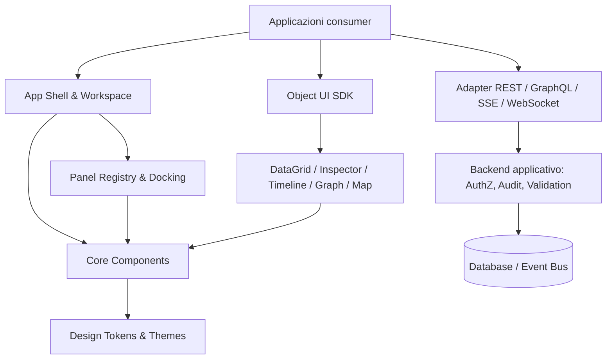
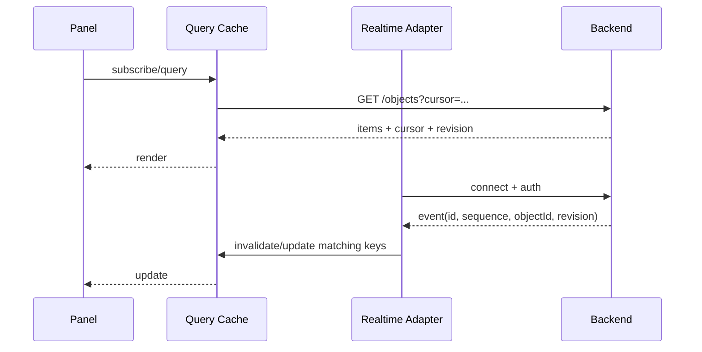

# Operational UI — System Design & Design System

> **Versione:** 1.0 · **Stato:** specifica implementativa · **Target:** applicazioni enterprise desktop-first, React/TypeScript · **Lingua UI:** italiano, predisposizione i18n.

## 1. Obiettivo

Realizzare un **design system originale**, riutilizzabile in software documentali, piattaforme di intelligence, monitoraggio, amministrazione e analisi. I riferimenti concettuali sono Palantir Blueprint (componenti data-dense), Palantir Foundry (interazione orientata agli oggetti) e World Monitor (dashboard modulare, pannelli, mappe, eventi live). **Non copiare codice, marchi, icone o asset visivi di World Monitor** nel prodotto proprietario senza una valutazione della licenza.

### Principi
1. **Density with clarity:** molti dati senza sacrificare gerarchia e leggibilità.
2. **Object-first:** ogni record ha identità, proprietà, relazioni e azioni.
3. **Operational by default:** stato, freschezza del dato, errori e audit sempre visibili.
4. **Composable:** componenti e pannelli indipendenti; layout persistenti.
5. **Secure by design:** controllo accessi lato server; frontend mai autoritativo.
6. **Accessible:** WCAG 2.2 AA come obiettivo, tastiera, screen reader, contrasto.
7. **Performance:** virtualizzazione, lazy loading, streaming controllato.

## 2. Ambito e non-obiettivi

**In scope:** token, temi dark/light, componenti, shell, pannelli docking, data grid, inspector, command palette, notifiche, timeline, grafi, mappe, logging UI, catalogo Storybook, test, pacchetti pubblicabili.

**Out of scope per MVP:** backend applicativo completo, raccolta dati OSINT, motore GIS proprietario, replica dell'Ontology Palantir, autenticazione proprietaria, feed di terzi. Il sistema fornisce contratti e adapter per integrarli.

## 3. Architettura logica



### Confini di responsabilità
- **Design system:** presentazione, accessibilità, stato locale, interfacce tipizzate.
- **Application layer:** routing, composizione delle viste, orchestrazione delle query, business logic non sensibile.
- **Backend:** autenticazione, autorizzazione, validazione, persistenza, audit, rate limiting e protezione dei dati.
- **Adapter:** conversione di payload esterni in contratti UI, retry limitato, cancellazione richieste, gestione errori.

## 4. Stack e decisioni architetturali

| Area | Scelta proposta | Motivazione |
|---|---|---|
| Framework | React + TypeScript strict | ecosistema e contratti forti |
| Base componenti | Palantir Blueprint (se compatibile con versioni selezionate) | componenti enterprise, licenza Apache-2.0 |
| Styling | CSS Modules + CSS custom properties | isolamento, temi runtime, overhead contenuto |
| Monorepo | pnpm workspaces + Turborepo | pacchetti separati e cache build |
| Documentazione | Storybook | esempi, stati, controlli, visual testing |
| Tabelle | TanStack Table + TanStack Virtual | headless, grandi dataset |
| Stato UI | Zustand | stato leggero e selettori |
| Fetch/cache | TanStack Query | cache, invalidazione, abort |
| Mappe | MapLibre GL JS (opzionale) | motore mappa separato |
| Grafi | adapter libreria dedicata, selezione in fase 3 | evitare dipendenze pesanti nel core |
| Unit test | Vitest + Testing Library | comportamento e accessibilità |
| E2E | Playwright | flussi, keyboard, visual regression |
| Quality | ESLint, TypeScript, audit dipendenze | prevenzione regressioni |

**Decisione importante:** Blueprint è una dipendenza opzionale confinata in `packages/blueprint-adapter`; l'API pubblica di `core` non deve esporre tipi Blueprint. Questo evita lock-in e permette di sostituire il motore UI in futuro.

## 5. Struttura repository

```text
operational-ui/
├── apps/
│   ├── storybook/
│   └── playground/
├── packages/
│   ├── tokens/                 # CSS variables, JSON token, temi
│   ├── core/                   # Button, Input, Badge, Dialog, Tooltip, Menu
│   ├── blueprint-adapter/      # adapter opzionale
│   ├── icons/                  # icone originali / licenziate
│   ├── layout/                 # AppShell, TopBar, Sidebar, DockWorkspace
│   ├── data/                   # DataGrid, Inspector, ObjectView, Timeline
│   ├── monitoring/             # Alerts, Status, Logs, MetricCard
│   ├── maps/                   # MapViewer e layer registry (lazy)
│   ├── graphs/                 # RelationshipGraph (lazy)
│   ├── object-sdk/             # modelli, schemi, actions, adapters
│   └── utils/                  # formatter, date, safe helpers
├── docs/
│   ├── architecture/
│   ├── accessibility/
│   ├── security/
│   └── decisions/              # ADR
├── .github/workflows/
├── package.json
├── pnpm-workspace.yaml
└── turbo.json
```

**Packaging:** export map esplicita, ESM, declaration files, `sideEffects` controllato per CSS, versionamento SemVer e Changesets; peer dependency React; tree shaking; no import di moduli GIS/graph dal barrel del core.

## 6. Design tokens

### Palette dark (default)

| Token | HEX | Ruolo |
|---|---|---|
| `--oui-bg` | `#0B0E11` | canvas |
| `--oui-bg-secondary` | `#11161C` | sidebar |
| `--oui-surface` | `#18212B` | pannelli |
| `--oui-surface-hover` | `#202C38` | hover |
| `--oui-border` | `#2B3742` | separatori |
| `--oui-text` | `#E6EDF3` | testo |
| `--oui-text-secondary` | `#98A6B3` | secondario |
| `--oui-text-muted` | `#647482` | metadati non critici |
| `--oui-accent` | `#2D9CDB` | azioni |
| `--oui-success` | `#29C785` | successo |
| `--oui-warning` | `#F2B84B` | attenzione |
| `--oui-danger` | `#E55353` | errore |
| `--oui-critical` | `#FF4242` | severità critica |

**Nota:** verificare con test automatici i rapporti di contrasto di ogni combinazione foreground/background. `text-muted` non va usato per testi essenziali se non raggiunge il contrasto richiesto. Non comunicare mai severità usando solo colore.

### Token strutturali

```css
:root[data-theme="dark"] {
  --oui-bg: #0b0e11;
  --oui-bg-secondary: #11161c;
  --oui-surface: #18212b;
  --oui-surface-hover: #202c38;
  --oui-border: #2b3742;
  --oui-text: #e6edf3;
  --oui-text-secondary: #98a6b3;
  --oui-accent: #2d9cdb;
  --oui-success: #29c785;
  --oui-warning: #f2b84b;
  --oui-danger: #e55353;
  --oui-critical: #ff4242;
  --oui-radius-sm: 3px;
  --oui-radius-md: 6px;
  --oui-space-1: 4px;
  --oui-space-2: 8px;
  --oui-space-3: 12px;
  --oui-space-4: 16px;
  --oui-topbar-height: 44px;
  --oui-statusbar-height: 26px;
  --oui-sidebar-width: 220px;
  --oui-inspector-width: 320px;
  --oui-font-ui: Inter, system-ui, sans-serif;
  --oui-font-mono: "JetBrains Mono", ui-monospace, monospace;
}
```

Creare tema light con **token semantici equivalenti**, non inversione automatica. Densità configurabile: `compact` (righe 28–32 px), `comfortable` (36–40 px). Target interattivi e spaziature devono rimanere accessibili anche in compact mode.

### Tipografia
- Titolo pagina: 18–20 px / semibold.
- Header pannello: 11–12 px / semibold / letter spacing leggero.
- Corpo: 13 px / regular.
- Tabelle: 12–13 px.
- Metadata/log: 11–12 px / mono ove appropriato.
- Focus ring: 2 px visibile, indipendente da hover.

## 7. Layout operativo

```text
┌────────────────────────────────────────────────────────────────┐
│ Brand │ Workspace ▾ │ Global Search / Cmd+K │ Sync │ User │ ⚙ │
├────────────┬───────────────────────────────────┬───────────────┤
│ Sidebar    │ Main Workspace                    │ Inspector     │
│ Navigation │ ┌───────────────┬───────────────┐ │ Object detail │
│ Saved views│ │ Panel A       │ Panel B       │ │ Relations     │
│ Filters    │ ├───────────────┴───────────────┤ │ Actions       │
│            │ │ Panel C                       │ │ Audit         │
│            │ └───────────────────────────────┘ │               │
├────────────┴───────────────────────────────────┴───────────────┤
│ Activity Console: events / jobs / logs / alerts                │
├────────────────────────────────────────────────────────────────┤
│ Connection status │ Last sync │ Pending jobs │ App version     │
└────────────────────────────────────────────────────────────────┘
```

### Regole
- Topbar 44 px, statusbar 26 px.
- Sidebar 220 px, collapsed 52 px.
- Inspector 320 px, richiudibile.
- Console inferiore altezza iniziale 200 px, ridimensionabile.
- Pannelli con `minWidth`/`minHeight`; evitare layout inutilizzabili.
- Breakpoint: `>=1440` desktop completo; `1024–1439` inspector overlay; `<1024` navigazione drawer e un pannello principale per volta.
- Persistenza per `userId + workspaceId + layoutVersion`; reset sicuro su layout non valido.
- Docking solo tramite libreria con manutenzione e licenza verificate; mantenere adapter astratto.

## 8. Catalogo componenti e contratti

| Componente | Responsabilità | Stati obbligatori |
|---|---|---|
| `AppShell` | cornice app | ready, loading, error |
| `TopBar` | navigazione e stato | online, reconnecting, offline |
| `Sidebar` | navigazione e viste | expanded, collapsed |
| `Panel` | contenitore componibile | idle, loading, empty, error |
| `DockWorkspace` | disposizione pannelli | drag, resize, restore |
| `DataGrid` | dati strutturati | sorting, filtering, pagination, selection |
| `ObjectInspector` | dettaglio entità | loading, missing, forbidden, ready |
| `StatusBadge` | stato semantico | neutral, success, warning, error, critical |
| `MetricCard` | KPI | fresh, stale, unavailable |
| `ActivityConsole` | eventi e log | paused, live, filtered |
| `CommandPalette` | azioni rapide | search, empty, results, disabled |
| `AlertCenter` | alert operativi | unread, acknowledged, resolved |
| `Timeline` | cronologia eventi | live, historical |
| `MapViewer` | mappe e layer | loading, offline, layer-error |
| `RelationshipGraph` | relazioni oggetti | loading, filtered, selected |

Ogni componente deve avere props tipizzate, controlled/uncontrolled dove appropriato, supporto keyboard, test unitari, storie Storybook, esempi e documentazione degli eventi. `dangerouslySetInnerHTML` vietato nel core; se richiesto da un adapter, sanificare con policy dedicata e test.

## 9. Object UI — modello dati

```ts
export type ObjectId = string;
export type ISODateTime = string;

export interface ObjectRelation {
  id: string;
  type: string;
  targetId: ObjectId;
  label?: string;
}

export interface OperationalObject<T extends Record<string, unknown> = Record<string, unknown>> {
  id: ObjectId;
  type: string;
  title: string;
  properties: T;
  relations: ObjectRelation[];
  status: string;
  updatedAt: ISODateTime;
  version: number;
}

export interface ObjectAction {
  id: string;
  label: string;
  intent: 'default' | 'primary' | 'danger';
  requiresConfirmation?: boolean;
}

export interface ObjectViewDefinition {
  objectType: string;
  columns: string[];
  inspectorSections: string[];
  availableViews: Array<'table' | 'timeline' | 'map' | 'graph'>;
}
```

**Regola di sicurezza:** `availableActions` nel client è solo un suggerimento UI; il backend deve verificare tenant, identità, permessi e stato dell'oggetto ad **ogni** esecuzione. Non inviare proprietà sensibili al client se non necessarie. Usare schemi runtime (es. Zod) ai confini API e versionare i contratti.

### Esempio di composizione

```tsx
<OperationalWorkspace workspaceId="archive">
  <ObjectDataGrid objectType="document" />
  <ObjectInspector objectType="document" />
  <ActivityConsole />
</OperationalWorkspace>
```

Questo è **pseudocodice di API desiderata**, non codice già implementato.

## 10. Gestione stato e flussi dati

Separare rigorosamente:
1. **Server state** (TanStack Query): fetch, cache, invalidazione, polling.
2. **UI state** (Zustand): pannelli, selezione, densità, tema, filtri temporanei.
3. **Persisted preferences**: layout, colonne, viste, ordinamento, per utente/workspace.
4. **Realtime state**: stream SSE/WebSocket con sequenza eventi e riconnessione.

### Flusso realtime



- Reconnect con exponential backoff + jitter, tetto massimo e stop su logout.
- Heartbeat e badge `live / delayed / offline`.
- Gestione eventi duplicati o fuori ordine con `sequence`/`revision`.
- Non accodare illimitatamente eventi: batching/throttling UI, backpressure.
- Non memorizzare token di accesso in localStorage se evitabile; preferire sessioni protette gestite dal backend.

## 11. API contract minimo (esemplificativo)

```http
GET    /api/v1/objects?type=document&cursor=...&limit=50
GET    /api/v1/objects/{id}
GET    /api/v1/objects/{id}/relations
GET    /api/v1/objects/{id}/actions
POST   /api/v1/objects/{id}/actions/{actionId}
GET    /api/v1/events?cursor=...
GET    /api/v1/workspaces/{id}/layout
PUT    /api/v1/workspaces/{id}/layout
GET    /api/v1/stream  (SSE, se autorizzato)
```

Risposte di errore in formato coerente, ad esempio RFC 9457 Problem Details con `type`, `title`, `status`, `detail` non sensibile e `traceId`. Il `traceId` collega messaggi UI e log backend; dettagli interni solo a ruoli autorizzati. Validare input, limitare dimensioni payload, applicare rate limit e idempotency key alle operazioni mutative dove necessario.

## 12. Sicurezza e privacy

- **AuthN:** OIDC/OAuth2 gestiti dall'applicazione host; MFA per ruoli sensibili.
- **AuthZ:** RBAC/ABAC server-side; tenant isolation su query, oggetti, stream e download.
- **Audit:** registrare chi/cosa/quando/esito/traceId, senza segreti o dati non necessari.
- **XSS:** escaping React, sanitizzazione HTML se indispensabile, CSP restrittiva.
- **CSRF:** protezioni coerenti con modalità di sessione/cookie; cookie Secure/HttpOnly/SameSite quando applicabili.
- **Supply chain:** lockfile, dependency scanning, SBOM, provenance per release.
- **Secrets:** nessuna API key nel bundle frontend; credenziali solo lato server.
- **Realtime:** autorizzare anche iscrizione a canali e singoli eventi.
- **Export:** autorizzazione server-side, limiti di volume e audit.
- **Privacy:** minimizzazione dei dati, retention configurabile, redazione log, niente dati sensibili in telemetria UI.
- **Mappe/font/media:** valutare telemetria e trasferimenti a terze parti; prevedere self-hosting.

## 13. Performance e resilienza

### Budget iniziali (da verificare su hardware target)
- Shell interattiva: obiettivo p75 < 2 s su desktop aziendale e rete standard.
- Interazione locale semplice: p95 < 100 ms.
- Data grid: virtualizzazione oltre 200 righe; nessun render integrale di 10.000 righe.
- Pannelli mappa/grafo caricati on demand.
- Rendering eventi: batching ogni 100–250 ms se necessario, con indicatori di backlog.
- Bundle budget per package e controllo regressioni in CI.

### Resilienza
- Error boundaries per pannello, non soltanto globali.
- Stati `loading`, `empty`, `error`, `stale`, `offline` distinti.
- AbortController su richieste obsolete.
- Retry solo per operazioni sicure/idempotenti; rispettare `Retry-After` per 429.
- Non duplicare mutazioni in caso di timeout.
- Layout corrotto: fallback al preset predefinito.

## 14. Accessibilità e UX

- Obiettivo WCAG 2.2 AA, verificato con axe e test manuali.
- Focus visibile e ordine di tabulazione prevedibile.
- Docking/resize con alternativa da tastiera e comandi menu.
- Tabelle con header semantici, ordinamento annunciato e navigazione assistiva.
- Alert con icona/testo oltre al colore; `aria-live` usato con moderazione.
- Animazioni ridotte con `prefers-reduced-motion`.
- Supporto zoom 200%, ridimensionamento testo, localizzazione date/numero.
- Scorciatoie documentate e configurabili quando interferiscono con tecnologie assistive.

## 15. Observability

Ogni operazione applicativa deve poter essere correlata tra frontend e backend:

```json
{
  "event": "object.action.failed",
  "traceId": "trace-example",
  "objectType": "document",
  "action": "approve",
  "httpStatus": 503,
  "severity": "error",
  "audience": "technical",
  "timestamp": "2026-11-12T09:00:00Z"
}
```

Non inserire PII, token, contenuto documentale o stack trace nei log destinati agli utenti. Prevedere messaggi separati per **utente**, **tecnico** e **amministratore**, secondo permessi. Tracing OpenTelemetry opzionale e adapter per provider di log.

## 16. Piano di sviluppo

### Fase 0 — Foundation
- [ ] Monorepo, lint, format, TypeScript strict, test runner, CI.
- [ ] ADR su dipendenze, licenze e API pubbliche.
- [ ] Tokens dark/light, contrast checker, typography, spacing.
- [ ] Storybook con documentazione di base.

### Fase 1 — Core MVP
- [ ] Button, Input, Select, Checkbox, Badge, Tooltip, Dialog, Menu.
- [ ] AppShell, TopBar, Sidebar, Panel, StatusBar.
- [ ] DataGrid virtualizzata con sorting/filtering/paginazione server-side.
- [ ] ObjectInspector e StatusBadge.
- [ ] Playground con dati mock realistici.

### Fase 2 — Operational Workspace
- [ ] DockWorkspace e persistenza layout versionata.
- [ ] CommandPalette, saved views, filtri condivisi.
- [ ] ActivityConsole, AlertCenter, timeline.
- [ ] Realtime adapter con reconnect e deduplica.
- [ ] Ruoli UI e contratti backend di autorizzazione.

### Fase 3 — Intelligence Extensions
- [ ] MapViewer con layer registry.
- [ ] RelationshipGraph con selezione sincronizzata.
- [ ] Object UI SDK e definizioni dichiarative.
- [ ] Dashboard configurabili e presets.
- [ ] Export autorizzato e audit integrato.

### Fase 4 — Hardening e release
- [ ] Test unitari, E2E, accessibilità, visual regression.
- [ ] Benchmark bundle e rendering.
- [ ] Dependency audit, SBOM, threat modeling.
- [ ] Documentazione API e migration guide.
- [ ] Release SemVer, changelog, pacchetti pubblicabili.

## 17. Definition of Done

Una feature è pronta solo quando:
1. Compila con TypeScript strict senza errori.
2. Ha storie Storybook per stati principali ed edge case.
3. Supporta tastiera, focus, screen reader e contrasto verificato.
4. Gestisce loading, empty, error e fallback.
5. Ha test unitari e, se interattiva, E2E.
6. Non introduce dipendenze pesanti nel core né regressioni di bundle.
7. Non espone segreti, dati non autorizzati o dettagli tecnici a utenti generici.
8. Ha documentazione di props, eventi e breaking changes.
9. Funziona in dark e light, compact e comfortable.
10. Rispetta i vincoli di licenza delle dipendenze.

## 18. Istruzioni per agente di coding (Codex / altri)

> Implementa il repository `operational-ui` a partire da questo documento. Procedi per fasi e crea codice realmente eseguibile. Inizia con monorepo, token, shell, componenti base, Storybook e playground. Usa TypeScript strict, dipendenze versionate e test. Non creare backend fittizi che simulino sicurezza: usa mock espliciti nel playground e interfacce per backend reali. Non copiare codice/asset da World Monitor; trattalo come ispirazione visiva. Mantieni `core` indipendente da Blueprint e da mappe/grafi. Prima di aggiungere librerie, verifica compatibilità, manutenzione e licenze. Dopo ogni fase esegui typecheck, lint, unit test, build e riporta i risultati. Non dichiarare completata una funzione senza testarla. Documenta ogni decisione architetturale significativa in `docs/decisions`.

### Primo incremento richiesto
1. Creare workspace pnpm e configurazioni condivise.
2. Implementare token CSS, tema dark/light e densità.
3. Creare `AppShell`, `TopBar`, `Sidebar`, `Panel`, `StatusBadge`, `Button`.
4. Realizzare playground con layout simile allo schema, dati mock e pannelli ridimensionabili **solo se l'adapter è già pronto**.
5. Pubblicare storie Storybook e test per ogni componente.
6. Aggiungere README con setup, script, architettura e limiti noti.

## 19. Riferimenti e licenze

- Palantir Blueprint: https://github.com/palantir/blueprint — toolkit React, Apache-2.0.
- World Monitor: https://github.com/koala73/worldmonitor — dashboard open source, codice AGPL-3.0-only; consultare `LICENSE` e `docs/license.mdx`.
- World Monitor license guide: https://github.com/koala73/worldmonitor/blob/main/docs/license.mdx
- Palantir Foundry docs: https://www.palantir.com/docs/foundry/ontology/overview/

**Nota legale:** ispirazione a pattern e principi non equivale a licenza per riutilizzare codice, marchi o asset. Valutare le licenze effettive delle dipendenze prima della distribuzione commerciale.
